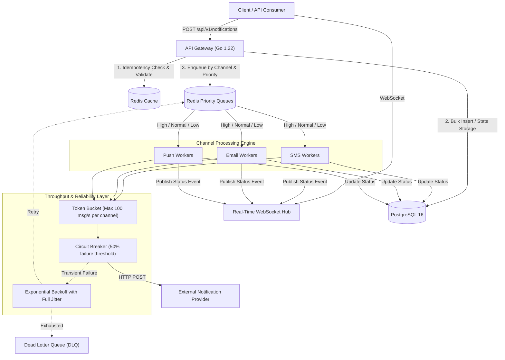

# Event-Driven Notification System

A high-throughput, horizontally scalable, event-driven notification platform engineered in **Go (1.22+)**. The system processes and dispatches millions of messages across **SMS**, **Email**, and **Push** channels, enforcing strict per-channel rate limits (100 messages/sec per channel), priority queuing (`high`, `normal`, `low`), intelligent exponential backoff retries with full jitter, circuit breaking, idempotency, and real-time status tracking.

---

## Architecture Overview



---

## Key Features

- **Multi-Channel Delivery**: Independent pipelines for **SMS**, **Email**, and **Push** notifications to prevent head-of-line blocking.
- **Batch Processing**: Ingestion of up to **1,000 notifications per request** with atomic/bulk database persistence in $< 50$ms.
- **Strict Channel Rate Limiting**: Exactly **100 messages per second per channel** enforced via distributed Redis Token Bucket.
- **Three-Tier Priority Queues**: `high`, `normal`, and `low` priorities with anti-starvation Weighted Fair Queuing (6:3:1) and priority aging.
- **Intelligent Retry Logic**: Exponential backoff with full jitter, automatic transient vs permanent error classification, and Dead Letter Queue (DLQ).
- **Circuit Breaker**: Detects downstream provider degradation and trips to prevent cascading connection pool exhaustion.
- **Strict Idempotency**: Header-based (`X-Idempotency-Key`) deduplication preventing duplicate sends across network retries.
- **Real-Time Observability**: Prometheus `/metrics` endpoint reporting queue depths, delivery latencies, and success/failure rates; structured JSON logging with correlation IDs.
- **Bonus Capabilities**:
  - Scheduled future delivery (Redis Sorted Sets).
  - Dynamic template system with variable substitution (`{{var}}`).
  - Real-time status updates via WebSockets.
  - OpenTelemetry distributed tracing.
  - Automated CI/CD pipeline via GitHub Actions.

---

## Documentation Library

Detailed engineering documentation and technical specifications are available in the [`docs/`](./docs) directory:

| Document | Purpose |
| :--- | :--- |
| [**Architecture & System Design**](./docs/ARCHITECTURE.md) | High-level component architecture, C4 diagrams, and ADRs. |
| [**System Design & Requirements**](./docs/SYSTEM_DESIGN_AND_REQUIREMENTS.md) | Functional & non-functional requirements, state machine, edge cases. |
| [**API Specification**](./docs/API_SPECIFICATION.md) | REST API endpoints, DTO contracts, WebSockets, and Webhook specs. |
| [**OpenAPI 3.0 YAML**](./docs/openapi.yaml) | Standard OpenAPI/Swagger 3.0 specification file. |
| [**Database Schema & Migrations**](./docs/DATABASE_SCHEMA.md) | Relational PostgreSQL schema, indexes, ER diagram, and DDL migrations. |
| [**Delivery & Retry Design**](./docs/DELIVERY_AND_RETRY_DESIGN.md) | Candidate-designed backoff formulas, circuit breaker, and DLQ. |
| [**Rate Limiting & Priority Queues**](./docs/RATE_LIMITING_AND_PRIORITY.md) | Token bucket algorithm (100 msg/s) and anti-starvation priority queues. |
| [**Bonus Features Design**](./docs/BONUS_FEATURES_DESIGN.md) | Scheduling, templates, WebSockets, and distributed tracing. |
| [**Implementation Roadmap**](./docs/IMPLEMENTATION_ROADMAP.md) | 8-phase actionable engineering roadmap and verification milestones. |
| [**Developer Setup Guide**](./docs/DEVELOPMENT_GUIDE.md) | Local environment setup, environment variables, and Make commands. |
| [**Testing Strategy**](./docs/TESTING_STRATEGY.md) | Unit, integration, E2E, rate limit verification, and load tests. |

---

## Quick Start (One-Command Setup)

### Prerequisites
- Docker & Docker Compose
- Go 1.22+ (for local bare-metal development)

### 1. Launch with Docker Compose
To start the API Server, Worker Pool, Mock Webhook Provider, PostgreSQL, Redis, and Prometheus in a single command:

```bash
docker compose up -d --build --wait
```

### 2. Verify Health
```bash
curl http://localhost:8080/health
```

### 3. Check Metrics
```bash
curl http://localhost:8080/metrics
```

---

## API Examples

### Send Single Notification
```bash
curl -i -X POST http://localhost:8080/api/v1/notifications \
  -H "Content-Type: application/json" \
  -H "X-Idempotency-Key: req-sms-001" \
  -d '{
    "recipient": "+905551234567",
    "channel": "sms",
    "content": "Your one-time security code is 912834.",
    "priority": "high"
  }'
```

### Send Batch Notifications (up to 1,000 items)
```bash
curl -i -X POST http://localhost:8080/api/v1/notifications/batch \
  -H "Content-Type: application/json" \
  -d '{
    "notifications": [
      {
        "recipient": "+905551234567",
        "channel": "sms",
        "content": "Flash Sale is LIVE!",
        "priority": "high"
      },
      {
        "recipient": "customer@example.com",
        "channel": "email",
        "content": "Your receipt for Order #4412",
        "priority": "normal"
      }
    ]
  }'
```

### Query Notification Status
```bash
curl -i -X GET http://localhost:8080/api/v1/notifications/{NOTIFICATION_ID}
```

### Cancel Pending Notification
```bash
curl -i -X POST http://localhost:8080/api/v1/notifications/{NOTIFICATION_ID}/cancel
```

---

## Running the Test Suite

Execute the entire test suite (unit + integration) with race detection using a single command:

```bash
make test
# Or directly with Go:
go test -v -race ./...
```

### Service-backed tests

Run `make test-integration` from a POSIX shell to start PostgreSQL and Redis and execute the entire race-enabled suite. The database login needs permission to create temporary test databases. Tests use Redis logical databases 7–15 on a development instance. The standalone `go test -v -race ./...` command runs the same integration cases when both `TEST_DATABASE_URL` and `TEST_REDIS_ADDR` are set. Without those settings, service-backed cases report SKIP.

### Local operation

The API runs on port 8080, the mock webhook on 8081, and Prometheus on 9090. Compose starts a scheduler and one worker pool for each channel. Each binary applies the embedded migrations at startup. Copy `.env.example` to `.env` to override defaults. Leave `PROVIDER_WEBHOOK_URL` unset to use the local mock. Set it to a reachable provider URL for external delivery.

- Set `WORKERS_PER_CHANNEL` to change goroutine concurrency. The shared admission ceiling is 100 provider calls per rolling second per channel. Slow responses reduce achievable throughput.
- Set `MOCK_FAILURE_STATUS=503` and optionally `MOCK_FAILURE_RECIPIENT` in Compose to exercise retries. A permanent response such as 422 exercises immediate DLQ routing.
- Use `go run ./cmd/cli dlq list --channel sms` to inspect failures and `go run ./cmd/cli dlq replay --channel sms --limit 20 --priority high` to replay them. Replay preserves prior audit records.
- Scrape `/metrics` on the API for queue depths, fleet-wide provider attempt counts and latency histograms. Prometheus also scrapes worker-local results, retry and throttling counters.
- Set `OTEL_EXPORTER_OTLP_ENDPOINT=http://collector:4317` to export spans to a reachable OTLP/gRPC collector. Trace context propagates across ingestion, queue processing and the provider call.
- Use `scheduledAt` for future delivery. Create a template with `POST /api/v1/templates`, then send `templateId`, `recipient` and `variables` in place of literal content. Status events stream at `ws://localhost:8080/api/v1/ws/notifications`, optionally filtered by `batch_id` or `channel`.

### Delivery guarantees

A 202 receipt confirms the PostgreSQL commit of both message data and dispatch instructions. Worker crashes and interrupted queue publishing are recoverable. If a provider accepts a POST and the worker crashes before recording the result, delivery can be attempted again. The stable notification ID is sent as `X-Idempotency-Key` on every provider attempt. External providers must honor that key to suppress duplicate side effects.

The phase-by-phase implementation and test evidence is in [the engineering reports](./docs/reports/).
