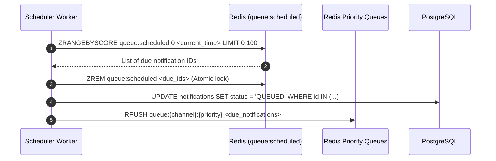
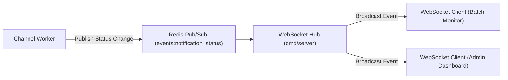
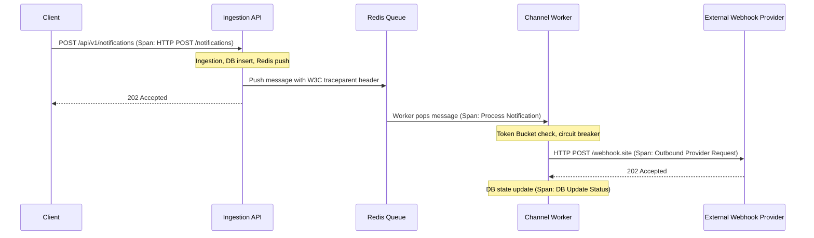

# Bonus Features Architecture & Technical Design

## 1. Advanced Failure Handling & DLQ Management

### 1.1. Poison Pill Isolation
A "poison pill" is a malformed message that triggers an unhandled exception or panic in the worker process.
- **Recovery Middleware**: Every worker goroutine runs with a `recover()` defer block.
- **Immediate Quarantine**: If a message triggers a panic or fatal unmarshalling error, it is caught, logged with the panic stack trace, quarantined directly to `queue:{channel}:quarantine`, and marked `FAILED` in the database without being retried to prevent infinite worker crash loops.

### 1.2. Dead Letter Queue (DLQ) Replay CLI
A management CLI (`cmd/cli`) is designed to inspect and replay DLQ messages after an outage is resolved:
```bash
# View DLQ summary across channels
go run ./cmd/cli dlq list --channel sms

# Replay up to 500 failed notifications back to the high priority queue
go run ./cmd/cli dlq replay --channel sms --limit 500 --priority high
```

---

## 2. Scheduled Notifications Engine

### 2.1. Scheduling Workflow
Clients can specify `scheduledAt` (ISO 8601 UTC timestamp) in the creation request.
1. When `scheduledAt > now`, the API marks the notification as `SCHEDULED` in PostgreSQL.
2. The notification ID is added to a Redis Sorted Set:
   ```redis
   ZADD queue:scheduled <unix_timestamp_seconds> <notification_id>
   ```

### 2.2. Polling & Promotion Dispatcher
A lightweight scheduler thread runs every 1 second:


---

## 3. Template Engine with Variable Substitution

### 3.1. Template Structure & Compilation
Templates allow decoupling presentation from backend logic.
- **Syntax**: Double-curly braces `{{variable_name}}` (compliant with Go `text/template` and Mustache).
- **Template Schema**:
  ```json
  {
    "id": "e5c786a3-8254-4be6-8e58-692fc35bc354",
    "name": "order_shipped_sms",
    "channel": "sms",
    "bodyTemplate": "Hi {{name}}, your order #{{orderId}} has shipped via {{carrier}}! Track here: {{trackingUrl}}"
  }
  ```

### 3.2. Dynamic Interpolation at Ingestion
When a client submits:
```json
{
  "templateId": "e5c786a3-8254-4be6-8e58-692fc35bc354",
  "variables": {
    "name": "Sarah",
    "orderId": "ORD-9912",
    "carrier": "DHL",
    "trackingUrl": "https://track.example.com/ORD-9912"
  }
}
```
The ingestion layer retrieves the cached compiled template, interpolates values, validates character limits against the rendered string, and enqueues the final message.

---

## 4. Real-Time Status Updates via WebSocket

### 4.1. WebSocket Architecture
To allow web dashboards or user apps to monitor delivery in real time:



### 4.2. Connection & Protocol
- Endpoint: `GET /api/v1/ws/notifications`
- Headers: `Upgrade: websocket`
- Clients can filter the stream by passing query parameters:
  - `?batch_id=<id>`: Receives events only for the specified batch.
  - `?channel=<channel>`: Receives events for a specific channel.

---

## 5. Distributed Tracing with OpenTelemetry

### 5.1. End-to-End Trace Propagation
Distributed tracing provides millisecond-level insight into where time is spent from API ingestion through queuing to webhook delivery:



### 5.2. Trace Exporter
The system configures an OpenTelemetry tracer exporting to a local **Jaeger** or OpenTelemetry Collector instance via OTLP/gRPC (`localhost:4317`).

---

## 6. GitHub Actions CI/CD Pipeline

The `.github/workflows/ci.yml` pipeline automates validation on every commit and pull request:
1. **Linting**: Runs `golangci-lint` to check code style, bug patterns, and cyclomatic complexity.
2. **Unit & Race Tests**: Runs `go test -race -v -coverprofile=coverage.out ./...`.
3. **Integration Tests**: Spins up PostgreSQL and Redis service containers inside the runner to test end-to-end batch ingestion, rate limiting, and retry behavior.
4. **Docker Build**: Verifies that the multi-stage `Dockerfile` builds cleanly.
