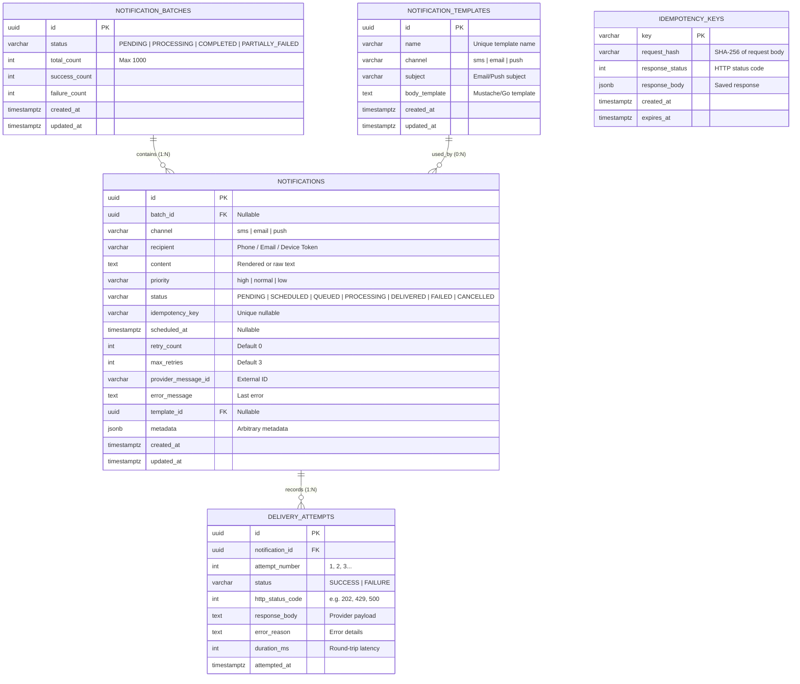

# Database Schema & Migration Specification

## 1. Overview & Strategy

The persistence layer uses **PostgreSQL 16** as the authoritative system of record.
- **Relational Integrity**: Enforces foreign key constraints between batches, notifications, and delivery attempts.
- **High-Throughput Indexing**: Optimized composite indexes support high-speed pagination, status filtering, and scheduled task scanning.
- **Versioned Migrations**: Managed via `golang-migrate/migrate` with paired `.up.sql` and `.down.sql` files.

---

## 2. Entity-Relationship (ER) Diagram



---

## 3. SQL Data Definition Language (DDL)

### Migration: `000001_init_schema.up.sql`

```sql
-- Enable UUID extension
CREATE EXTENSION IF NOT EXISTS "uuid-ossp";

-- Enum Types
DO $$ BEGIN
    CREATE TYPE channel_type AS ENUM ('sms', 'email', 'push');
EXCEPTION
    WHEN duplicate_object THEN null;
END $$;

DO $$ BEGIN
    CREATE TYPE priority_type AS ENUM ('high', 'normal', 'low');
EXCEPTION
    WHEN duplicate_object THEN null;
END $$;

DO $$ BEGIN
    CREATE TYPE notification_status AS ENUM (
        'PENDING',
        'SCHEDULED',
        'QUEUED',
        'PROCESSING',
        'DELIVERED',
        'FAILED',
        'CANCELLED'
    );
EXCEPTION
    WHEN duplicate_object THEN null;
END $$;

DO $$ BEGIN
    CREATE TYPE attempt_status AS ENUM ('SUCCESS', 'FAILURE');
EXCEPTION
    WHEN duplicate_object THEN null;
END $$;

-- 1. Notification Batches Table
CREATE TABLE IF NOT EXISTS notification_batches (
    id UUID PRIMARY KEY DEFAULT uuid_generate_v4(),
    status VARCHAR(32) NOT NULL DEFAULT 'PROCESSING',
    total_count INT NOT NULL CHECK (total_count > 0 AND total_count <= 1000),
    success_count INT NOT NULL DEFAULT 0,
    failure_count INT NOT NULL DEFAULT 0,
    created_at TIMESTAMPTZ NOT NULL DEFAULT NOW(),
    updated_at TIMESTAMPTZ NOT NULL DEFAULT NOW()
);

-- 2. Notification Templates Table (Bonus)
CREATE TABLE IF NOT EXISTS notification_templates (
    id UUID PRIMARY KEY DEFAULT uuid_generate_v4(),
    name VARCHAR(128) NOT NULL UNIQUE,
    channel channel_type NOT NULL,
    subject VARCHAR(255),
    body_template TEXT NOT NULL,
    created_at TIMESTAMPTZ NOT NULL DEFAULT NOW(),
    updated_at TIMESTAMPTZ NOT NULL DEFAULT NOW()
);

-- 3. Notifications Table (Core)
CREATE TABLE IF NOT EXISTS notifications (
    id UUID PRIMARY KEY DEFAULT uuid_generate_v4(),
    batch_id UUID REFERENCES notification_batches(id) ON DELETE SET NULL,
    channel channel_type NOT NULL,
    recipient VARCHAR(512) NOT NULL,
    content TEXT NOT NULL,
    priority priority_type NOT NULL DEFAULT 'normal',
    status notification_status NOT NULL DEFAULT 'PENDING',
    idempotency_key VARCHAR(256),
    scheduled_at TIMESTAMPTZ,
    retry_count INT NOT NULL DEFAULT 0,
    max_retries INT NOT NULL DEFAULT 3,
    provider_message_id VARCHAR(256),
    error_message TEXT,
    template_id UUID REFERENCES notification_templates(id) ON DELETE SET NULL,
    metadata JSONB DEFAULT '{}'::jsonb,
    created_at TIMESTAMPTZ NOT NULL DEFAULT NOW(),
    updated_at TIMESTAMPTZ NOT NULL DEFAULT NOW()
);

-- 4. Delivery Attempts Table (Audit & Debugging)
CREATE TABLE IF NOT EXISTS delivery_attempts (
    id UUID PRIMARY KEY DEFAULT uuid_generate_v4(),
    notification_id UUID NOT NULL REFERENCES notifications(id) ON DELETE CASCADE,
    attempt_number INT NOT NULL,
    status attempt_status NOT NULL,
    http_status_code INT,
    response_body TEXT,
    error_reason TEXT,
    duration_ms INT NOT NULL DEFAULT 0,
    attempted_at TIMESTAMPTZ NOT NULL DEFAULT NOW()
);

-- 5. Idempotency Keys Table (Persistent Deduplication)
CREATE TABLE IF NOT EXISTS idempotency_keys (
    key VARCHAR(256) PRIMARY KEY,
    request_hash VARCHAR(64) NOT NULL,
    response_status INT NOT NULL,
    response_body JSONB NOT NULL,
    created_at TIMESTAMPTZ NOT NULL DEFAULT NOW(),
    expires_at TIMESTAMPTZ NOT NULL
);

-- Indexes for Fast Querying and Filtering
CREATE INDEX IF NOT EXISTS idx_notifications_status_channel_created ON notifications(status, channel, created_at DESC);
CREATE INDEX IF NOT EXISTS idx_notifications_batch_id ON notifications(batch_id) WHERE batch_id IS NOT NULL;
CREATE INDEX IF NOT EXISTS idx_notifications_scheduled ON notifications(scheduled_at) WHERE status = 'SCHEDULED';
CREATE UNIQUE INDEX IF NOT EXISTS idx_notifications_idempotency_key ON notifications(idempotency_key) WHERE idempotency_key IS NOT NULL;
CREATE INDEX IF NOT EXISTS idx_delivery_attempts_notification_id ON delivery_attempts(notification_id, attempt_number DESC);
CREATE INDEX IF NOT EXISTS idx_idempotency_keys_expires_at ON idempotency_keys(expires_at);
```

### Migration: `000001_init_schema.down.sql`

```sql
DROP TABLE IF EXISTS delivery_attempts CASCADE;
DROP TABLE IF EXISTS notifications CASCADE;
DROP TABLE IF EXISTS notification_templates CASCADE;
DROP TABLE IF EXISTS notification_batches CASCADE;
DROP TABLE IF EXISTS idempotency_keys CASCADE;

DROP TYPE IF EXISTS attempt_status CASCADE;
DROP TYPE IF EXISTS notification_status CASCADE;
DROP TYPE IF EXISTS priority_type CASCADE;
DROP TYPE IF EXISTS channel_type CASCADE;
```

---

## 4. Query Performance & Partitioning Considerations

For production systems generating over 10 million notifications per day:
1. **Range Partitioning by Month**: The `notifications` and `delivery_attempts` tables can be partitioned by `RANGE (created_at)` (e.g. `notifications_2026_11`). This allows historical cold partitions to be dropped or archived to object storage without locking active tables.
2. **Index Optimization**:
   - The composite index `(status, channel, created_at DESC)` ensures that API queries filtering by channel, status, and sorted by date execute in $< 5$ms using an Index Scan without requiring sort buffers.
   - Partial index on `scheduled_at WHERE status = 'SCHEDULED'` keeps the index size minuscule for the scheduler scanner.
3. **Connection Pooling**:
   - Database connection pools must be configured with sensible bounds (e.g., `MaxOpenConns: 50`, `MaxIdleConns: 25`, `ConnMaxLifetime: 15m`) to prevent connection exhaustion during batch ingestion spikes.
