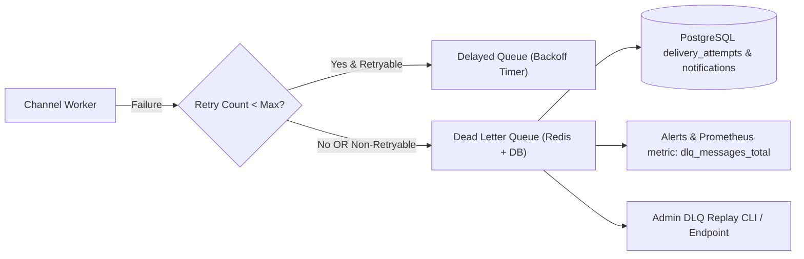

# Delivery & Retry Engine Design

## 1. Overview & Objectives

In high-throughput notification systems, downstream external providers experience network partitions, latency spikes, and transient 5xx or 429 rate limit errors. The Delivery & Retry Engine is designed to guarantee **reliable, at-least-once delivery**, prevent cascading failures, and avoid overwhelming external providers during incidents.

---

## 2. Error Classification Architecture

Every external provider response or network anomaly is classified immediately into one of two operational categories:

```
+-----------------------------------------------------------------------------------------+
| TRANSIENT (RETRYABLE)                               | PERMANENT (NON-RETRYABLE)         |
+-----------------------------------------------------------------------------------------+
| - HTTP 429 Too Many Requests (Rate Limited)         | - HTTP 400 Bad Request            |
| - HTTP 500 Internal Server Error                    | - HTTP 401 / 403 Authentication   |
| - HTTP 502 Bad Gateway                              | - HTTP 404 Not Found              |
| - HTTP 503 Service Unavailable                      | - HTTP 422 Unprocessable Entity   |
| - HTTP 504 Gateway Timeout                          | - Malformed recipient address     |
| - TCP Connection Refused / Reset                    | - Content policy violations       |
| - DNS Resolution Timeout / Socket Timeout           | - Invalid channel credentials     |
+-----------------------------------------------------------------------------------------+
| ACTION: Enqueue for Exponential Backoff Retry       | ACTION: Mark FAILED & Move to DLQ |
+-----------------------------------------------------------------------------------------+
```

---

## 3. Exponential Backoff with Full Jitter

To prevent the **Thundering Herd** problem—where thousands of retried notifications wake up simultaneously and cause repeated downstream outages—we implement **Exponential Backoff with Full Jitter** (as proven by AWS Architecture Research).

### 3.1. Mathematical Formula
Given an attempt index $i \in \{1, \dots, N_{\text{max}}\}$:

$$\text{Temp} = \min(t_{\text{max}}, t_{\text{base}} \times 2^{i-1})$$
$$t_{\text{sleep}} = \text{UniformRandom}(0, \text{Temp})$$

### 3.2. Configuration Parameters
- **Base Delay ($t_{\text{base}}$)**: $1.0\text{ second}$
- **Max Delay ($t_{\text{max}}$)**: $60.0\text{ seconds}$
- **Max Retry Count ($N_{\text{max}}$)**: $3\text{ retries}$ (Total 4 delivery attempts)

### 3.3. Retry Schedule Progression
| Attempt Number | Calculation ($t_{\text{base}} \times 2^{i-1}$) | Full Jitter Window | Expected Average Delay |
| :--- | :--- | :--- | :--- |
| **Attempt 1 (Initial)**| $0\text{ s}$ | $0\text{ s}$ (Immediate) | $0\text{ s}$ |
| **Attempt 2 (Retry 1)**| $1.0\text{ s}$ | $[0.0\text{ s}, 1.0\text{ s}]$ | $0.5\text{ s}$ |
| **Attempt 3 (Retry 2)**| $2.0\text{ s}$ | $[0.0\text{ s}, 2.0\text{ s}]$ | $1.0\text{ s}$ |
| **Attempt 4 (Retry 3)**| $4.0\text{ s}$ | $[0.0\text{ s}, 4.0\text{ s}]$ | $2.0\text{ s}$ |
| **Exhausted** | - | Transition to `FAILED` & move to DLQ | - |

---

## 4. Circuit Breaker Pattern

To protect downstream provider APIs during prolonged outages, each channel is wrapped with a **Circuit Breaker** (using `sony/gobreaker` or equivalent state machine).

```mermaid
stateDiagram-v2
    [*] --> CLOSED
    
    CLOSED --> OPEN: Consecutive Failures >= 5 OR Failure Rate >= 50% (Window: 10s)
    note right of OPEN: Requests fail fast without calling provider; tasks pushed to delayed retry queue.
    
    OPEN --> HALF_OPEN: Cooldown period expires (30s)
    note right of HALF_OPEN: Allow trial probe requests through.
    
    HALF_OPEN --> CLOSED: Probe requests succeed (consecutive successes >= 3)
    HALF_OPEN --> OPEN: Any probe request fails
```



### 4.1. Circuit Breaker Settings
- **Window Size**: 10 seconds (minimum 10 requests to evaluate).
- **Failure Threshold**: $50\%$ failure rate or 5 consecutive 5xx/timeout errors.
- **Cooldown Interval**: 30 seconds before transitioning to `HALF-OPEN`.
- **Half-Open Success Threshold**: 3 consecutive successful probe deliveries to reset to `CLOSED`.

---

## 5. Dead Letter Queue (DLQ) Architecture

When a notification cannot be delivered after exhausting all retry attempts or encounters an irrecoverable non-retryable error, it is directed to the channel's **Dead Letter Queue (DLQ)**.



### 5.1. DLQ Metadata Payload
When routed to the DLQ, the record persists:
- `notification_id`: UUID of the notification.
- `last_error_code`: HTTP status code or network error string.
- `last_error_reason`: Provider error response body.
- `total_attempts`: Cumulative attempts made.
- `terminal_reason`: `MAX_RETRIES_EXCEEDED` or `NON_RETRYABLE_ERROR`.
- `failed_at`: Timestamp of final failure.

---

## 6. Delivery Attempt Audit Logging

Every interaction with an external provider creates an immutable record in `delivery_attempts`:
- Enables root-cause analysis for customer support.
- Powers real-time latency percentiles (P50, P95, P99).
- Provides compliance logs verifying whether and when a notification left the internal perimeter.
