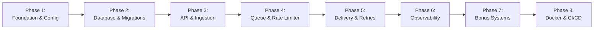

# Implementation Roadmap & Engineering Plan

## 1. Executive Implementation Roadmap

This roadmap breaks down the complete construction of the **Event-Driven Notification System** into eight structured, testable engineering phases.

---

## 2. Phase-by-Phase Execution Plan

### Phase 1: Project Foundation, Architecture & Configuration
- **Objectives**: Establish clean project structure, dependency injection, environment configuration, and structured logging.
- **Tasks**:
  1. Initialize Go module (`go mod init event-driven-notification-system`).
  2. Adopt Standard Go Project Layout:
     - `cmd/server/main.go`: API Gateway entrypoint.
     - `cmd/worker/main.go`: Channel worker daemon.
     - `cmd/scheduler/main.go`: Scheduled notification ticker.
     - `internal/config/`: Configuration struct with environment variable loading.
     - `internal/domain/`: Core domain entities, types, value objects, and repository interfaces.
     - `pkg/logger/`: Structured JSON logging wrapping `log/slog`.
- **Deliverables**: Working hello-world entry points, structured JSON logs, configuration loading with `.env` support.

---

### Phase 2: Database Layer & Versioned Migrations
- **Objectives**: Implement relational persistence, connection pooling, and versioned migrations.
- **Tasks**:
  1. Author migration SQL files:
     - `migrations/000001_init_schema.up.sql`
     - `migrations/000001_init_schema.down.sql`
  2. Implement database connection pool (`pgxpool` or `database/sql` with PostgreSQL driver).
  3. Implement repository pattern in `internal/repository/postgres`:
     - `NotificationRepository`: `Create`, `CreateBatch`, `GetByID`, `GetByBatchID`, `UpdateStatus`, `ListWithFilters`, `Cancel`.
     - `DeliveryAttemptRepository`: `RecordAttempt`, `GetByNotificationID`.
     - `IdempotencyRepository`: `Get`, `Store`.
- **Deliverables**: Schema migrations runnable via CLI/make; unit/integration tests verifying multi-row batch inserts and queries.

---

### Phase 3: REST API, Ingestion Engine & Idempotency
- **Objectives**: Build high-throughput REST endpoints, request validators, and batching mechanisms.
- **Tasks**:
  1. Set up router (`chi` or `gin`) with middlewares:
     - Correlation ID injection (`X-Correlation-ID`).
     - Structured HTTP request/response logger.
     - Panic recovery middleware.
     - Idempotency guard (`X-Idempotency-Key` check in Redis/DB).
  2. Implement API Handlers:
     - `POST /api/v1/notifications` (Single notification).
     - `POST /api/v1/notifications/batch` (Batch up to 1,000 notifications).
     - `GET /api/v1/notifications/{id}` (Status query with attempts).
     - `GET /api/v1/notifications/batches/{batch_id}` (Batch aggregate status).
     - `POST /api/v1/notifications/{id}/cancel` (Cancellation endpoint).
     - `GET /api/v1/notifications` (List with status/channel/date filters & pagination).
  3. Implement Channel Payload Validators (SMS E.164, Email RFC 5322, Push token).
- **Deliverables**: Fully functional, validated REST API passing unit tests.

---

### Phase 4: Queue Infrastructure, Priority Scheduling & Rate Limiting
- **Objectives**: Build Redis queue infrastructure, priority handling, and channel rate limiting.
- **Tasks**:
  1. Implement Redis broker client (`internal/queue/redis`):
     - Publisher: Pushes notifications to `queue:{channel}:{priority}`.
     - Consumer: Implements Weighted Fair Queue (6 High : 3 Normal : 1 Low).
     - Priority aging scanner to prevent starvation.
  2. Implement Distributed Token Bucket Rate Limiter (`internal/ratelimit`):
     - Redis Lua script enforcing **100 msgs/second per channel**.
     - Configurable capacity (100) and refill rate (100 tokens/sec).
  3. Worker Goroutine Pool:
     - Controlled concurrency per channel pool.
     - Graceful context-driven shutdown (`SIGTERM`/`SIGINT`).
- **Deliverables**: Channel workers pulling from priority queues while strictly adhering to the 100 msg/s rate limit.

---

### Phase 5: External Provider Integration, Delivery & Retries
- **Objectives**: Build provider client, exponential backoff, circuit breaker, and DLQ.
- **Tasks**:
  1. Implement outbound HTTP Provider Client (`internal/provider`):
     - Formats payload: `{"to": "...", "channel": "...", "content": "..."}`.
     - Expects HTTP 202: `{"messageId": "...", "status": "accepted", "timestamp": "..."}`.
     - Configurable external target URL from `PROVIDER_WEBHOOK_URL`.
  2. Implement Error Classifier (Transient vs Permanent).
  3. Implement Exponential Backoff with Full Jitter:
     - Calculates sleep time, puts message in `queue:{channel}:delayed` (Redis ZSET).
  4. Implement Circuit Breaker (`sony/gobreaker`):
     - Protects against cascading failures when provider is down.
  5. Implement Dead Letter Queue (DLQ):
     - Routes exhausted retries or non-retryable 4xx errors to DLQ with detailed failure reason.
- **Deliverables**: Resilient delivery engine that survives provider timeouts, rate limits, and errors.

---

### Phase 6: Observability, Metrics & Health Checks
- **Objectives**: Real-time system monitoring, Prometheus metrics, and distributed tracing.
- **Tasks**:
  1. Implement Prometheus exporter (`/metrics`):
     - Queue depth gauges (`notifications_queue_depth{channel, priority}`).
     - Delivery counters (`notifications_delivered_total{channel, status}`).
     - Latency histograms (`notification_delivery_duration_seconds{channel}`).
     - Rate limit throttles (`ratelimit_throttled_total{channel}`).
     - Retry counters (`notification_retries_total{channel, attempt}`).
  2. Health & Readiness probes (`/health`, `/ready`):
     - Checks PostgreSQL ping and Redis ping.
  3. OpenTelemetry distributed tracing (W3C TraceContext headers propagation).
- **Deliverables**: Production-ready `/metrics` and `/health` endpoints.

---

### Phase 7: Bonus Features (Scheduler, Templates, WebSockets)
- **Objectives**: Enhance the system with scheduled deliveries, dynamic templates, and live status streaming.
- **Tasks**:
  1. Scheduled Delivery Dispatcher (`cmd/scheduler`):
     - Evaluates `queue:scheduled` ZSET every 1 second and promotes due tasks to priority queues.
  2. Template Engine (`internal/template`):
     - CRUD for templates (`POST /api/v1/templates`).
     - Mustache / Go text template parser for variable substitution (`{{name}}`).
  3. Real-Time WebSocket Hub (`internal/websocket`):
     - Endpoint: `GET /api/v1/ws/notifications`.
     - Listens to Redis Pub/Sub status events and broadcasts to connected clients.
- **Deliverables**: End-to-end support for scheduled messages, templates, and WebSocket notifications.

---

### Phase 8: Containerization, Testing Suite & CI/CD
- **Objectives**: One-command local startup, robust testing suite, and automated CI.
- **Tasks**:
  1. Multi-stage `Dockerfile`:
     - Builds minimal, secure Alpine/scratch binaries.
  2. `docker-compose.yml`:
     - Services include `postgres`, `redis`, `api`, `scheduler`, one worker per channel, and `prometheus`.
     - One-command setup (`docker-compose up --build`).
  3. Comprehensive Test Suite:
     - Single command execution: `make test`.
     - Unit tests for validation, rate limiting, and backoff formulas.
     - Integration tests for batch ingestion and priority ordering.
     - Load testing script (e.g., k6 or Go benchmark) simulating 1,000 batch and 100 msg/s bursts.
  4. GitHub Actions CI pipeline (`.github/workflows/ci.yml`).
- **Deliverables**: Fully automated local setup and passing automated test pipeline.
