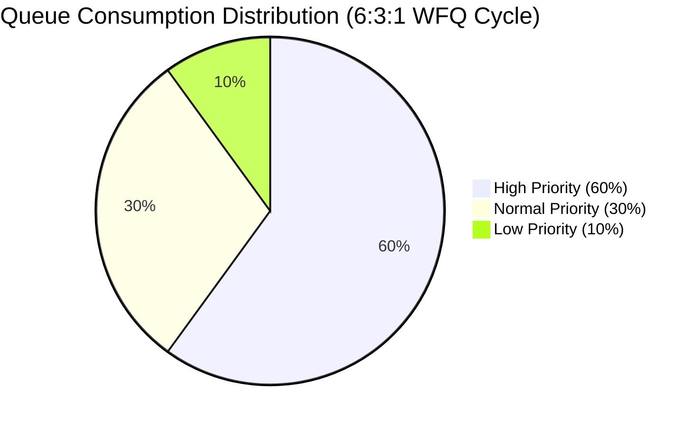

# Rate Limiting & Priority Queuing Architecture

## 1. Rate Limiting Architecture

### 1.1. Core Constraint
The processing engine enforces a **strict maximum throughput of 100 messages per second per channel**:
- **SMS Channel**: $\le 100\text{ msg/sec}$
- **Email Channel**: $\le 100\text{ msg/sec}$
- **Push Channel**: $\le 100\text{ msg/sec}$
- **Total Combined System Throughput**: $\le 300\text{ msg/sec}$

### 1.2. Token Bucket Algorithm Design
We implement the **Token Bucket** algorithm over Leaky Bucket or Fixed Window because:
1. It permits short, natural micro-bursts up to capacity $C=100$.
2. It guarantees that the sustained rate never exceeds $100\text{ tokens/second}$.
3. It has minimal memory overhead ($\mathcal{O}(1)$ state per channel).

```
   +-----------------------------------------------+
   |        Token Refill: 100 tokens / sec         |
   +-----------------------------------------------+
                         |
                         v
                +-----------------+
                |   TOKEN BUCKET  |
                |  Capacity = 100 |
                +-----------------+
                         |
           +-------------+-------------+
           | Request arrives           |
           v                           v
     Tokens Available?           Bucket Empty?
           |                           |
         [YES]                       [NO]
           |                           |
   Consume 1 Token               Sleep / Defer
   Dispatch Notification        until next token
```

### 1.3. Distributed Atomic Redis Token Bucket (Lua)
When running multiple worker replicas, rate limiting must be coordinated atomically across instances using a Redis Lua script:

```lua
-- KEYS[1]: channel rate limit key (e.g. "ratelimit:sms")
-- ARGV[1]: max capacity (100)
-- ARGV[2]: refill rate per second (100)
-- ARGV[3]: current timestamp in milliseconds
-- ARGV[4]: requested tokens (1)

local key = KEYS[1]
local capacity = tonumber(ARGV[1])
local refill_rate = tonumber(ARGV[2])
local now = tonumber(ARGV[3])
local requested = tonumber(ARGV[4])

local state = redis.call("HMGET", key, "tokens", "last_updated")
local tokens = tonumber(state[1])
local last_updated = tonumber(state[2])

if tokens == nil then
    tokens = capacity
    last_updated = now
else
    local elapsed = (now - last_updated) / 1000.0
    tokens = math.min(capacity, tokens + (elapsed * refill_rate))
    last_updated = now
end

if tokens >= requested then
    tokens = tokens - requested
    redis.call("HMSET", key, "tokens", tokens, "last_updated", last_updated)
    redis.call("EXPIRE", key, 2)
    return 1 -- Allowed
else
    redis.call("HMSET", key, "tokens", tokens, "last_updated", last_updated)
    redis.call("EXPIRE", key, 2)
    return 0 -- Throttled
end
```

---

## 2. Priority Queue Architecture

### 2.1. Priority Tiers
Every notification belongs to one of three priority tiers:
1. `high`: Security OTPs, password reset codes, transactional receipts, critical security alerts.
2. `normal`: System notifications, social interactions, shipping updates.
3. `low`: Marketing campaigns, weekly digests, re-engagement emails.

### 2.2. Queue Storage Topology
In Redis, each channel maintains dedicated priority queues:
- `queue:{channel}:high`
- `queue:{channel}:normal`
- `queue:{channel}:low`

### 2.3. Anti-Starvation Dispatcher: Weighted Fair Queuing (WFQ)
A naive approach that strictly checks `high` before `normal` and `normal` before `low` can completely starve `low` priority messages during sustained peak bursts.

To eliminate starvation while guaranteeing high priority processing, workers apply a **Weighted Fair Queue (WFQ)** consumption cycle with a **6:3:1** ratio:



### 2.4. Aging Mechanism (Time-to-Live Elevation)
In addition to WFQ, an **Aging Engine** periodically inspects items in lower priority queues:
- If a `low` priority notification remains unconsumed for $> 30\text{ seconds}$, it is automatically elevated to `normal`.
- If an item in `normal` remains unconsumed for $> 60\text{ seconds}$, it is elevated to `high`.
- This provides an upper bound on latency even during maximum throughput load.

---

## 3. Backpressure & Capacity Sizing

| Metric | Target / SLA | Action upon Exceeding |
| :--- | :--- | :--- |
| **High Priority Queue Delay** | $< 500\text{ ms}$ | Alert trigger; dynamic worker pool scale-out |
| **Normal Priority Queue Delay**| $< 5.0\text{ s}$ | Log warning; monitor rate limits |
| **Low Priority Queue Delay** | $< 60.0\text{ s}$ | Priority aging elevates items |
| **Per-Channel Throughput** | Exactly 100/sec | Token bucket sleep interval applied |
| **Worker In-Flight Buffer** | $\le 200$ items | Pauses queue consumer fetching until in-flight clears |
