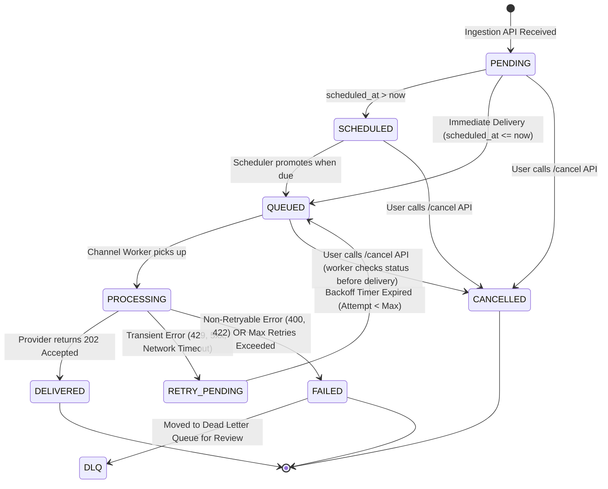

# System Design & Requirements Specification

## 1. System Mission & Scope

The **Event-Driven Notification System** is designed to provide enterprise-grade, high-volume message delivery across **SMS**, **Email**, and **Push** channels. The platform serves as the central communication backbone for high-velocity transaction bursts, automated campaigns, and critical alerts.

---

## 2. Functional Requirements Breakdown

### 2.1. Notification Management API

| Requirement | Description | Acceptance Criteria |
| :--- | :--- | :--- |
| **Single Notification Creation** | Create individual notifications with recipient, channel, content, and priority. | - Accepts JSON payload.<br>- Returns 202 Accepted with notification ID, status `QUEUED` or `SCHEDULED`, and timestamp.<br>- Validates all fields strictly. |
| **Batch Notification Creation** | Accept up to 1,000 notifications in a single HTTP request. | - Rejects batches $> 1,000$ with 400 Bad Request.<br>- Processes batch insertion in bulk (target DB write $< 50$ms).<br>- Returns a unique `batch_id` and list of generated notification IDs. |
| **Notification Status Query** | Retrieve status and delivery attempt history by notification ID. | - Returns current status, channel, recipient, created/updated timestamps, delivery attempts, error messages, and provider message ID. |
| **Batch Status Query** | Retrieve aggregate delivery statistics by `batch_id`. | - Returns total count, breakdown by status (`PENDING`, `QUEUED`, `PROCESSING`, `DELIVERED`, `FAILED`, `CANCELLED`), and completion percentage. |
| **Notification Cancellation** | Cancel pending or queued notifications before they are processed. | - Transitions state to `CANCELLED`.<br>- Evicts/skips message in worker if already enqueued.<br>- Returns 200 OK with cancelled status, or 409 Conflict if already `PROCESSING` or `DELIVERED`. |
| **Listing & Pagination** | List notifications with multi-attribute filtering and pagination. | - Filter by `status` (comma-separated list).<br>- Filter by `channel` (`sms`, `email`, `push`).<br>- Filter by date range (`start_date`, `end_date`).<br>- Cursor-based or keyset/offset pagination with `limit` (default 20, max 100) and `page` / `cursor`. |

---

### 2.2. Processing Engine & Channel Workers

| Requirement | Description | Technical Implementation |
| :--- | :--- | :--- |
| **Asynchronous Worker Pools** | Decoupled background processing away from synchronous HTTP request threads. | Worker pools consume messages from Redis queues using concurrent goroutines. |
| **Strict Rate Limiting** | **Maximum 100 messages per second per channel** across all running worker instances. | Distributed Token Bucket using Redis. Ensures SMS $\le 100$/s, Email $\le 100$/s, Push $\le 100$/s. |
| **Priority Queue Handling** | Strict prioritization: `High` > `Normal` > `Low`. | High priority notifications are dequeued first. Starvation prevention mechanism (aging or weighted ratio 6:3:1) ensures lower priority messages progress. |
| **Content Validation** | Channel-specific data validation before queuing and processing. | Validate recipient formatting, character lengths, UTF-8 validity, and mandatory fields. |
| **Idempotency Protection** | Prevent duplicate message sends caused by network retries or client duplicate calls. | Cache `Idempotency-Key` in Redis with 24h TTL. Store SHA-256 payload hash to detect conflicting duplicate requests. |

---

### 2.3. Channel-Specific Validation Rules

```
+---------------------------------------------------------------------------------------+
| CHANNEL  | RECIPIENT VALIDATION         | CONTENT CONSTRAINTS                         |
+---------------------------------------------------------------------------------------+
| SMS      | E.164 phone format           | - GSM-7: Max 160 characters per segment     |
|          | (e.g., +905551234567)        | - Unicode: Max 70 characters per segment    |
|          | Regexp: ^\+[1-9]\d{1,14}$    | - Absolute max limit: 1600 characters       |
+---------------------------------------------------------------------------------------+
| Email    | RFC 5322 Email regex         | - Subject line: 1 - 255 characters          |
|          | (e.g., user@example.com)     | - Body: Plaintext or HTML (max 500 KB)      |
+---------------------------------------------------------------------------------------+
| Push     | Device token string          | - Title: 1 - 128 characters                 |
|          | (Alphanumeric/Base64, 32-256)| - Body: 1 - 2048 characters                 |
|          |                              | - Custom Data: Valid JSON Object (max 4 KB) |
+---------------------------------------------------------------------------------------+
```

---

## 3. Notification Lifecycle & State Machine



### State Definitions:
1. `PENDING`: Initial persisted record in the database before routing.
2. `SCHEDULED`: Target delivery time is in the future; stored in delayed task storage.
3. `QUEUED`: Pushed to Redis channel priority list awaiting available worker thread.
4. `PROCESSING`: Leased by an active worker; token bucket slot acquired.
5. `DELIVERED`: Successfully accepted by external provider (HTTP 202 received).
6. `RETRY_PENDING`: Transient failure encountered; backoff timer calculated and queued.
7. `FAILED`: Terminal failure; cannot be retried (or maximum retries exhausted).
8. `CANCELLED`: Interrupted and cancelled by client prior to provider transmission.

---

## 4. Non-Functional Requirements (NFRs)

### 4.1. Throughput & Scalability
- **Ingestion Target**: Minimum 5,000 notifications/second at the API ingestion layer.
- **Batch Latency**: Processing an ingestion batch of 1,000 items should complete in under 150 ms (P95).
- **Delivery Rate**: Exactly 100 msgs/second per channel (300 msgs/second across 3 channels concurrently).
- **Horizontal Scalability**: Stateless API nodes and stateless worker nodes capable of scaling independently in Kubernetes or Docker Swarm.

### 4.2. Reliability & Fault Tolerance
- **At-Least-Once Delivery**: Every message enqueued must be either delivered or moved to the Dead Letter Queue (DLQ). No message loss during worker crashes.
- **Worker Crash Safety**: Redis `RPOPLPUSH` or Redis Streams acknowledgments ensure in-flight messages are recovered if a worker process crashes mid-execution.
- **Database Resilience**: Read/write connection pool tuning, automatic reconnection with exponential backoff, and transactional consistency for batch operations.

### 4.3. Observability & Auditability
- **Correlation Tracking**: Every request generates or propagates an `X-Correlation-ID` (UUIDv4) passed through HTTP headers, database records, Redis messages, worker execution logs, and outbound external provider calls.
- **Structured Logs**: Standardized JSON logs using Go 1.22 `log/slog` containing timestamp, level, message, correlation_id, notification_id, channel, duration_ms, and caller.
- **Metrics**: Real-time Prometheus metrics exported at `/metrics`.

---

## 5. Critical Edge Cases & Mitigation Strategies

### 5.1. Burst Traffic Spike Handling
- **Symptom**: Ingestion of 500,000 notifications in 10 seconds during a flash sale.
- **Mitigation**:
  - API accepts messages asynchronously into PostgreSQL in chunks of 1,000 using `COPY` or parameterized multi-row insert.
  - Redis priority queues buffer the backlog instantly without throttling the HTTP API.
  - Channel workers consume strictly at the bounded 100 msg/sec rate without overwhelming downstream providers.

### 5.2. Worker Crash Mid-Processing
- **Symptom**: Worker OS process terminates after popping a message from Redis but before HTTP response is recorded.
- **Mitigation**:
  - The worker uses an "in-flight" processing set with a heartbeat/visibility timeout.
  - A scavenger worker periodically checks for messages in `PROCESSING` state whose heartbeat expired (>60s) and requeues them.

### 5.3. External Provider Outage (HTTP 500 / 503 Cascades)
- **Symptom**: External webhook endpoint goes down or experiences severe degraded performance.
- **Mitigation**:
  - **Circuit Breaker**: Trips to `OPEN` state after 5 consecutive failures or >50% failure rate over 10 seconds.
  - Workers halt outbound HTTP requests during `OPEN` state, immediately pushing incoming tasks to the backoff queue rather than wasting connection pools and timing out.

### 5.4. Cancellation Race Condition
- **Symptom**: User cancels a notification while a worker is actively pulling it from the queue.
- **Mitigation**:
  - When `/cancel` is called, PostgreSQL status is updated to `CANCELLED` inside a database transaction.
  - When the worker dequeues a message, it performs a lightweight status verification or Redis cancelled set check right before invoking the external provider. If `CANCELLED`, the message is discarded without delivery.
